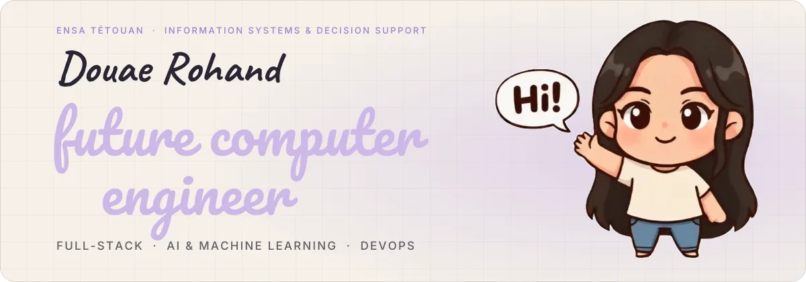
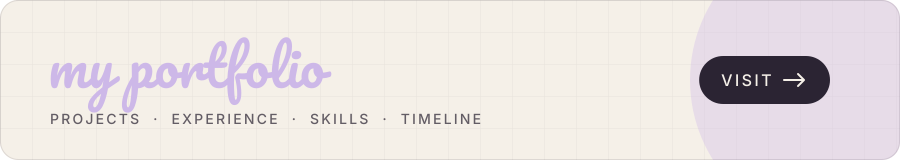

  

  
  
  

## About me
I'm a Computer Engineering student at **ENSA Tétouan** specializing in **Information Systems and Decision Support**. I build software like an orchestra: **software architecture** writes the score, **full-stack development** plays every instrument and brings every section in, from the interface on the surface to the data and APIs keeping the rhythm underneath, **AI and Machine Learning** add a soloist that listens and adapts, and **DevOps** is the conductor that keeps every part in time, from the first rehearsal to opening night.

**A few things I've built**

- **A paint booth that tells you when it's off-key (Renault Tanger):** reads temperature and humidity from a PLC, streams them to a real-time dashboard with PDF reports, and raises the alarm on several channels when conditions drift.
- **Rawabet, a CRM that never forgets a client:** an AI-powered real-estate platform (Spring Boot, React, PostgreSQL) with a RAG assistant to question client files, and n8n workflows that flag cold leads before they fade away.
- **SGITU, an ensemble where the show goes on when one player drops out:** urban transport microservices (Spring Cloud, Kafka) that keep talking when one of them fails, shipped through CI/CD and watched by Prometheus and Grafana.
- **AURORAS, a weather forecast for the sun's storms:** a Random Forest model that predicts geomagnetic storms up to 6 hours ahead, served through a containerized FastAPI and Streamlit app.

Looking for an **end-of-studies internship (PFE) starting February 2027**, where software engineering meets AI.

## Portfolio

  

## Technical stack

<table>
<tr><td><b>Languages</b></td><td align="center" width="96"> Java</td><td align="center" width="96"> Python</td><td align="center" width="96"> C#</td><td align="center" width="96"> PHP</td><td align="center" width="96"> JavaScript</td></tr>
<tr><td><b>Frontend</b></td><td align="center" width="96"> React</td><td align="center" width="96"> Vue.js</td><td align="center" width="96"> Tailwind</td><td align="center" width="96"> Bootstrap</td><td align="center" width="96"> Flutter</td></tr>
<tr><td><b>Backend</b></td><td align="center" width="96"> Spring Boot</td><td align="center" width="96"> FastAPI</td><td align="center" width="96"> Laravel</td><td align="center" width="96"> ASP.NET</td><td align="center" width="96"> Kafka</td></tr>
<tr><td><b>Databases</b></td><td align="center" width="96"> PostgreSQL</td><td align="center" width="96"> Oracle</td><td align="center" width="96"> MySQL</td><td align="center" width="96"> SQL Server</td></tr>
<tr><td><b>DevOps &amp; Tools</b></td><td align="center" width="96"> Docker</td><td align="center" width="96"> GitHub Actions</td><td align="center" width="96"> Git</td><td align="center" width="96"> Linux</td><td align="center" width="96"> Prometheus</td><td align="center" width="96"> Grafana</td></tr>
<tr><td><b>AI &amp; Data</b></td><td align="center" width="96"> scikit-learn</td><td align="center" width="96"> pandas</td><td align="center" width="96"> Streamlit</td><td align="center" width="96"> n8n</td></tr>
</table>

## GitHub activity

  

  

  <picture>
    <source media="(prefers-color-scheme: dark)" srcset="https://raw.githubusercontent.com/douae-rohand/douae-rohand/output/github-snake-dark.svg" />
    
  </picture>

## Profile Statistics

  
  
  

  <h3>Thanks for stopping by!</h3>
  If you found my profile interesting, don't forget to leave a ⭐ 
  <em>Let's connect and build something amazing together!</em> 
  

